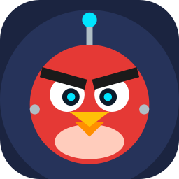

# AngryBot

An Android app that records you playing Angry Birds 2 level 11 and then replays it on its own. It runs on the phone by itself, with no PC, cable or root needed.

## How it works
AngryBot is an accessibility service. It puts a small floating control bar over the game:

| Button | What it does |
|---|---|
| ● Rec | A faint red layer covers the screen. Each drag or tap you make is saved, then sent to the game when you lift your finger. |
| ▶ Play | Replays the saved moves with the same timing. |
| ⟳ Loop | Replays again and again until you tap ■ Stop. |
| ■ Stop | Stops recording or playback. |
| ↶ Undo | Deletes the last saved move. |

Drag the bar by its **⠿ AngryBot** label.

## Download
**[⬇ Download AngryBot.apk](https://github.com/AlienHomie007/AngryBot/releases/latest/download/AngryBot.apk)**

Open that link on your Android phone, then open the downloaded file. Allow "Install unknown apps" when the phone asks. If you're updating, uninstall the old AngryBot first.

## Use it
1. Open AngryBot → **Open Accessibility settings** → turn on **AngryBot**.
2. Open Angry Birds 2 and go to level 11's start screen, the one with the **Play** button.
3. Tap **● Rec**. Play the level, including the Play tap and any card choices. While recording:
   - Pull the slingshot and let go. The red line shows your drag, and the shot fires when you lift your finger. You don't see the game's aiming line while recording, so aim by eye.
   - For a bird's ability, tap once while it's flying.
   - Wait for each move to happen before you touch the screen again. Touching too early cancels it.
4. After you win, also tap through the result screens back to level 11's start screen, then tap **■ Stop**. Recording those taps is what lets **⟳ Loop** start the next run.
5. If a shot missed, tap **● Rec** again to start a new recording (it replaces the old one).
6. From level 11's start screen, tap **▶ Play** or **⟳ Loop**.

## AngryBot AI (separate app)
**[⬇ Download AngryBot-AI.apk](https://github.com/AlienHomie007/AngryBot/releases/latest/download/AngryBot-AI.apk)** · Android 11+ · purple icon

A separate app that plays by itself instead of replaying a recording. It installs next to AngryBot and doesn't change it.

- **Live screen feed.** It watches the screen 30–60 times a second through Android's screen-capture feed. Frames stay in memory; nothing is saved. It reacts as soon as the game is ready instead of taking screenshots one by one.
- **Understands the screen.** It finds pigs, green buttons (Play, Continue, Retry) and red close (X) buttons. **It never presses a button that shows a gem price.** It waits while things move and nudges the game if it gets stuck.
- **Aims with physics and learns.** After every shot it checks what changed, corrects its aim, and switches arc or target after misses. It taps mid-flight to use the bird's power.

**Use it**
1. Turn on **AngryBot AI** in Accessibility settings. A purple bar appears.
2. In a level, tap **🎯 Calib**, then pull the bird *all the way back* and let go. You only need to do this once.
3. Tap **🧠 AI**, then tap **Start** on Android's screen-capture prompt. **■ Stop** ends it.
4. **👀 Watch** shows what it sees without making moves (cyan = pigs, yellow = buttons, orange = close X). **📸 Snap** saves that view to *Pictures/AngryBot*. Share the images so the colour rules in `ai/.../Vision.java` can be tuned.

## Limits
- It replays your moves exactly. It doesn't look at the screen. If Angry Birds 2 deals a different bird card, shows a pop-up or offer, or the physics play out slightly differently, a run can fail. Running Loop helps.
- Keep the phone in the same orientation and display settings you recorded with.
- Rovio's terms don't allow bots. Using one could get your account flagged, mainly in competitive modes like Arena or Clans. Use it at your own risk.
